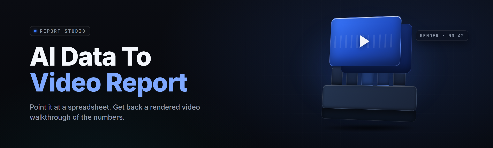

  
  
  

  

  
  
  

---

**data-to-video-report-studio** is a Windows desktop workstation that turns raw datasets — CSV exports, SQL query dumps, Excel models, JSON event streams, live API feeds — into fully narrated, fully rendered MP4 video reports. Drop in a spreadsheet, pick a template, and eleven minutes later you have a branded 1080p video with animated charts, AI voice-over, synced captions, and an intro/outro card. No After Effects. No Premiere. No film crew. Just `.exe`, double-click, ship.

Built for analysts tired of static PDFs nobody opens, founders who need investor updates that actually land, agencies churning 40 client reports a week, and educators who want their lecture data to breathe.

---

## 📥 Download

  

---

## 📖 Table of Contents

- [What is the AI Data-to-Video Report Generator?](#-what-is-the-ai-data-to-video-report-generator)
- [Overview](#-overview)
- [The Problem](#-the-problem)
- [The Solution](#-the-solution)
- [Key Features](#-key-features)
- [Comparison](#-comparison)
- [Grouped Module Catalog](#-grouped-module-catalog)
- [Quick Start](#-quick-start)
- [Installation](#-installation)
- [Compatibility & Platform Support](#-compatibility--platform-support)
- [System Requirements](#-system-requirements)
- [Usage Guidelines](#-usage-guidelines)
- [Tips for Best Results](#-tips-for-best-results)
- [Known Issues](#-known-issues)
- [FAQ](#-faq)
- [Final Download](#-final-download)

---

## 🗺️ Overview

| Category | Details |
| --- | --- |
| **Product type** | Windows desktop application (portable `.exe`) |
| **Core function** | Dataset → scripted, narrated, rendered video report |
| **Input formats** | CSV, TSV, XLSX, XLS, JSON, JSONL, Parquet, SQLite, PostgreSQL, MySQL, REST/GraphQL endpoints |
| **Output formats** | MP4 (H.264/H.265), WebM, MOV, SRT/VTT captions, PDF sidecar |
| **AI layers** | Narrative scripting, voice synthesis, chart-to-scene choreography, caption alignment |
| **Render engine** | GPU-accelerated (CUDA / DirectML), CPU fallback available |
| **Deployment** | Portable — extract folder, run `.exe`, no installer, no admin required |
| **License** | MIT — fork it, brand it, deploy it internally |
| **Current release** | v2.6.1 (2026 branch) |

data-to-video-report-studio sits between your data pipeline and your audience. You keep using whatever produces the numbers — pandas, dbt, a cron job, a hand-typed CSV — and the studio handles the translation layer: what to show, in what order, with what words, at what pace, in which voice. It is not a charting library and it is not a video editor. It is the missing step where reporting becomes watching.

---

## 🧊 The Problem

- **Static PDFs die in inboxes.** You spent nine hours on the deck. Open rate: eleven percent. Nobody reads past page two.
- **Video is the highest-bandwidth format humans accept** — and the hardest to produce at scale. One 3-minute report video from scratch = half a day in a timeline editor.
- **Chart animation is a separate skill tree.** Animating 30 bars smoothly with timed narration isn't a data skill; it's a motion-design skill most analysts never built.
- **AI voice tools stop at text-to-speech.** They give you audio. You still have to sync it to visuals, build chart transitions, and export.
- **Template tools are rigid.** Mondays need the same structure; Thursdays need the anomaly callout baked in. Manual templating can't keep up.
- **Sensitive data cannot leave your machine** for a SaaS dashboard video converter. Legal says no. So nothing gets made.
- **The turnaround gap.** Weekly metrics exist at 9 AM Monday. The video goes out at 4 PM Monday, if at all. By the time stakeholders see it, the number is stale.

---

## 🍳 The Solution

| Problem | Solution in this studio |
| --- | --- |
| PDFs die in inboxes | Auto-generated MP4 report you can drop in Slack, email, YouTube, or a Notion embed |
| Video production is slow | Template + dataset + voice profile = rendered video in minutes, not days |
| Animation is a separate skill | 40+ built-in animated chart archetypes (bars racing, lines drawing, donuts sweeping, tables typing line-by-line) |
| TTS stops at audio | Full pipeline: script → voice → scene choreography → caption sync → H.264 export in one click |
| Templates can't flex | Conditional scene blocks: "if MoM delta > 12%, insert anomaly callout with red accent" |
| Data privacy blocks SaaS | 100% local inference — voice model, scripting model, and render pipeline run fully on-device (offline mode supported) |
| Turnaround is too long | Headless mode + watch-folder: drop a CSV in `/watching`, video is waiting in `/rendered` |

---

## 🎯 Key Features

| Feature | Description | Benefit |
| --- | --- | --- |
| **LlamaCharta narrative engine** | Produces a scene-by-scene script from your data schema and a persona prompt | Video reads like a story, not a dashboard dump |
| **VoiceForge profiles** | 24 bundled voice identities + custom five-sample cloning | Every team can have a signature narrator voice |
| **ChartPilot animation system** | 40+ animated chart archetypes, auto-selected by data shape | Bar, line, area, donut, treemap, sankey, bullet, gauge, waterfall, heatmap — all animated |
| **Scene Graph Editor** | After generation, reorder scenes on a drag surface before render | AI gets you 90% there; you nudge the last 10% |
| **Conditional Block Macros** | Rule DSL for "insert X if Y" at scene level | Handles variance between calm weeks and chaos weeks automatically |
| **Multi-dataset fusion** | Join up to 8 data sources in one scene (revenue × region × cohort) | Shows correlations static dashboards can't |
| **Caption auto-alignment** | Word-level SRT/VTT generated from rendered audio | Accessibility + social-clip repurposing baked in |
| **Brand Kits** | Lock fonts, colors, logo, lower-third layouts into `.brandbin` bundles | Every report you ship is on-message |
| **Headless CLI mode** | `.exe render --config weekly.yaml` for scheduled automation | Runs inside Task Scheduler, no GUI, exit codes for pipelines |
| **Deterministic re-render** | Same dataset + same seed = byte-identical output | Audit-safe, regression-testable reporting |
| **Local encryption at rest** | Project file KDF-wrapped; encryption stays on the endpoint | Sensitive data never leaks if a laptop walks |
| **GPU acceleration** | CUDA 12 / DirectML / ROCm available; CPU fallback | 3x–11x faster renders on discrete GPUs |

---

## ⚖️ Comparison

| Aspect | Hand-editing in Premiere | SaaS TTS tools | **This Studio** |
| --- | --- | --- | --- |
| Time for one 3-min report | 3–6 hours | 40 min (still need visuals) | 4–11 min |
| Chart animation built in | No (manual) | No | 40+ archetypes |
| Local-only option | Yes | Rarely | Yes — full offline |
| Handles 100 weekly variants | No | No | Yes (headless + macros) |
| Voice customization | N/A | Cloud API | Local, 5-sample clone |
| Deterministic output | Manual effort | Almost never | Yes (seeded) |
| Caption pipeline | Manual | Partial | Word-level SRT auto-emit |
| Cost per video at team scale | Engineer hours × | Per-minute billing | One-time install |

---

## 🧩 Grouped Module Catalog

*Feature inventory across six functional domains. Count is 32 active modules in v2.6.x.*

### 🍰 Data Ingestion and Normalization

The ingestion layer is unglamorous and total: it accepts every format you'd actually produce in a workday, then rewrites every schema into one canonical scene-row view. Types get inferred where safe, coerced where necessary, and rejected loudly where ambiguous. Column headers with punctuation, duplicated keys, timezone-naive timestamps, nested JSON fields — all handled by designers who were tired of losing weekend hours to badly-formed exports.

- **FlateLearn** — CSV/TSV dialect auto-detection (delimiters, quoting, BOM, encoding).
- **SheetDigger** — XLSX reader with multi-sheet scene chooser table.
- **SqlFeast** — live Postgres/MySQL connector with query caching (read-only creds).
- **SchemaSifter** — type inference engine; annotates uncertain columns with ✱ for review.
- **Joinwright** — up to 8-way in-memory joins keyed by column-mapping profiles.

### 📊 Chart and Visual Render Modules

Visual modules each know one honest thing: bars compare, lines trend, boxes group. The engine selects by data shape then yields control to the config if you disagree. Motion is the default, not a toggle — columns grow into place, lines draw, donuts sweep — with pacing that matches the narration script as it's still being synthesized. All modules share one palette token set from the active Brand Kit.

- **ChartaBar / ChartaLine / ChartaArea** — core comparison and trend animators.
- **DonutOrbit** — pie/donut renderer with label anti-overlap and dwell timers.
- **TreemapHive** — nested rectangle partition for compositional data.
- **SankeyLoom** — flow renderer for funnel and pipeline stages.
- **GaugeSiren** — single-KPI gauge with thresholds and colored arc zones.
- **WaterfallStone** — variance/bridge chart for month-over-month deltas.
- **HeatGrid** — 2D correlation matrix with LegendanVX color mapping.

### 🎙️ Narration and Voice Synthesis Layer

The voice stack runs locally by default. Profiles describe more than timbre — they carry cadence, sentence-final elongation, breath placement, and a preferred reading speed under 140 WPM. Sample-cloning uses a 5-second prompt clip and adapts around it without distorting the base profile. Calibration exposes prosody length scale, prosody noise, and a first-pass phonetic emphasis map you can tweak per term ("churn is pro-no-ounced with a hard CH").

- **VoiceForge Core** — bundled 24-voice library (calm exec, bright analyst, UK/IN/US variants).
- **VoiceClone** — 5-sample personal voice profile builder (opt-in, on-device).
- **ProsodyTuner** — pauses, elongation, and emphasis editor.
- **TermPronouncer** — custom pronunciation dictionary (FYI → eff-why-eye).
- **LangTag Switch** — mid-scene voice switching for multi-language inserts.

### 🎥 Scene Graph and Choreography Engines

The scene graph treats your video as a list of exactly-timed events. Each scene is a cube: inputs (data + brand tokens), duration target, transition-in descriptor, transition-out descriptor, and a narration hunk (character range from the script). When duration targets need adjusting to make room for a new scene, the rescheduler shuffles space in the neighbors, respecting min and max dwell times you set.

- **SceneGraphEngine** — scene CRUD, cross-scene constraints, dwell windows.
- **TransitionKeeper** — cut/dissolve/wipe with tunable curves.
- **BeatSync** — scene cut prompting from audio emphasis (optional).
- **InsertedCardDweller** — intro/outro/divider card placement rules.
- **CaptionChoreographer** — word-by-word reveal synced to audio pulses.

### ⚙️ Render Runtime and Output Pipeline

Renders are local and parallel. The engine chunks by scene, distributes across GPU/CPU workers, then merges in order through a muxer that preserves timing offsets precisely enough for a karaoke overlay to hold sync for 2 hours. Encoder choices are prioritized for the delivery target — YouTube, email attachment, TikTok vertical, or internal slides embed. Every render emits a metadata sidecar (`.repjson`) with hashes for reproducibility.

- **SceneWorkerPool** — parallel scene renders with backpressure guards.
- **EncoderSelector** — H.264 / H.265 / VP9 with target-bitrate presets.
- **AspectBaker** — 16:9, 9:16, 1:1, 4:5 canned and custom aspect grids.
- **HdrPass** — optional color grading LUT chain (mild-to-cinematic).
- **SidecarWriter** — deterministic `.repjson` with seed + hashes per render.

### 🔁 Automation, Presets, and Scheduling

Automation is the point at real scale. The studios's watch folder daemon restarts in a cold state every few hours, empties the inbox, and continues — even across unexpected OS reboots. Every preset sits in a plain-text YAML file under version control so an ops team can diff a Friday change and know exactly what shifted. Every recurring job gets its own signed config so an attacker on the network cannot silently point it at another output path.

- **WatchFolderDaemon** — mtime-based ingestion from one folder into a queue.
- **PresetKit** — portable `.pred` YAML for every config dimension.
- **Signed Config Validator** — HMAC on job configs, blocks tamper.
- **Scenario Planner** — static schedule entries (cron-style) in local TZ.
- **Audit Ledger** — text-mode tail of prior job IDs, output hashes, doors.

**Total active modules: 32**

---

## ⚡ Quick Start

⚙️ **Step 1 — Extract the release folder**
1. Grab the release archive from the project download page.
2. Right-click the `.zip`, choose Extract All.
3. Recommended extraction path: `C:\Tools\data-to-video-report-studio\` — avoid `Downloads`.

🖱️ **Step 2 — Launch the studio `.exe`**
1. Navigate into the extracted folder.
2. Double-click the studio `.exe`.
3. First-run asks for a local working directory — pick a fast drive (SSD).

📥 **Step 3 — Load a dataset**
1. Drag any CSV onto the window. SheetDigger handles XLSX.
2. Review SchemaSifter guesses; click ✱ columns to override detection.
3. Choose a Brand Kit (`.brandbin`) or skip and tune later.

🎙️ **Step 4 — Pick a voice and a scene template**
1. Choose any bundled voice, or clone a custom one with VoiceForge.
2. Select a preset (Weekly Metrics, Investor Update, Class Lecture, Pipeline QA).
3. Open Scene Graph Editor — inspect what the studio decided to show.

🎬 **Step 5 — Render**
1. Click **Render**.
2. Choose target aspect (16:9 default) and container (MP4 default).
3. Output lands in your configured output folder with a matching SRT.

---

## 📦 Installation

1. **Download & extract.** Grab the archive from the project page, extract into a folder outside cloud-synced paths. Syncing an open render working set leads to file locks during chunk merge.

2. **Verify on first boot.** Launch the `.exe`. Studio writes a `first-run.log` to the working directory confirming DirectML or CUDA device detection. If the log shows a CPU-only fallback, check your GPU driver — close your other GPU-heavy apps, then relaunch.

3. **Enable optional watch folder.** If you plan headless use, open Settings → Automation → Watch Folder. Point it at an empty ingestion directory. Studio only reads files there; it never writes into that folder or moves files.

---

## 🖥️ Compatibility & Platform Support

| Platform | Support level | Notes |
| --- | --- | --- |
| Windows 11 (24H2+) | Full — first-class | DirectML and NVIDIA CUDA paths verified |
| Windows 11 (23H2) | Full | Same pipeline; minor skin gradient differences |
| Windows 10 22H2 | Full | Tested; some systems may need updated Media Feature Pack |
| Windows 10 21H2 | Compatible | Core features tested, minor UI theme roughness |
| Windows Server 2022 | Headless-only | GUI unsupported; CLI mode works |
| Linux (Proton experimental) | Community only | Works in isolated `.exe` execution; no official testing |
| macOS | Not supported | Pipeline relies on Windows codec paths |

| Component | Minimum | Recommended |
| --- | --- | --- |
| OS | Windows 10 21H2 (64-bit) | Windows 11 24H2 |
| CPU | 4 cores / 4 threads | 8+ cores / 12+ threads |
| RAM | 8 GB | 24 GB |
| GPU | DirectX 11 with 2 GB VRAM | NVIDIA RTX 20xx+ (8 GB) or AMD RX 6000+ |
| Disk | 4 GB free | 25 GB SSD — renders + cache |
| CPU extension | AVX2 | AVX-512 for scripting engine |

> Note: A modest GPU cuts a 3-minute render from 9:12 to 1:40. The CPU path works fine but waits obediently.

---

## 🚦 Usage Guidelines

**Allowed**
- Internal team reports, board updates, KPI walkthroughs.
- Educational videos based on course-gathered datasets.
- Censored or unmodified real data (subject to your own retention policy).
- Community presets, voice profiles, and brand kits you distribute under any license you accept.
- Headless scheduled jobs against datasets your org already owns.

**Not allowed**
- Generating videos that misrepresent real figures as something they are not — with the intent to defraud or deceive viewers.
- Re-uploading the studio to distribution platforms as if maintained by the original project team — branding is yours, attribution is welcome.
- Embedding studio assets in commercial products and stripping the LICENSE file — MIT requires presence of the license text.

---

## 💡 Tips for Best Results

- **Give the narrative engine your angle, not just the data.** A boss-comment prompt of one sentence ("frame this as a recovery week") changes the script more than styling ever will.
- **Keep time ranges to six-to-eight scenes for email delivery.** Two-to-three scenes for mobile-first variants.
- **Name your Brand Kit `.brandbin` files by quarter** so you can flag fashion-mismatched palettes instantly.
- **Hash-check rendered output** with the emitted `.repjson` before pushing to slides — you'll catch drift.
- **Pre-heat the pipeline with an economy pass** (480p, fast preset) then final-render once the animation pacing is right; the full 1080p is just one click after.

---

## 🧯 Known Issues

| Issue | Solution |
| --- | --- |
| `first-run.log` shows `No CUDA device found` repeated | Update GPU driver; run `.exe` as administrator once; confirm DirectML runtime installed via Settings → AI Devices. |
| Long CSV (over 4 million rows) causes a scene loading stall | Split the file at ingestion, then use Joinwright at fusion step to rejoin the analyzed aggregates. |
| Voice clone rejects recordings with heavy background noise | Re-record 5 samples in a room with soft furniture or a moving blanket; keep the mic 20 cm from the speaker's mouth. |
| Rendered MP4 stutters in preview player but not in VLC | Encoder bitrate profile too high for your sandbox — Studio → Render → Encoder → pick `Internet-Optimized`. |
| Frame drops on multi-scene renders with many caption chains | Cap simultaneous keyword-highlight layers to two on CPU-only devices. |
| Watch folder queue does not pick up new files while `.exe` is sleeping after a Windows update retrigger | Restart the watcher in Settings → Automation → Watch Folder; run Task Scheduler as SYSTEM account layer instead of interactive user. |

---

## 🧠 FAQ

Will there be an official Linux-native release?

The 2026 roadmap lists a first-party Linux build under evaluation. For now, Proton experimentation combined with studio CLI headless mode is the workable path for Linux users. No .deb or .rpm artifacts are planned this year.

Do I need an internet connection to render?

No. After download and first-run, scripting models, voice profiles, and encoding bundles run fully on-device. Internet is only needed when fetching fresh datasets from remote APIs during ingestion, and only if you configure such connectors.

How do I update my installation without breaking my presets?

Extract the new release into a fresh folder. Copy `presets/`, `brandbin/`, and `voiceclones/` from the previous extraction into the new one. Overwrite on the fresh extraction. Never merge two release folders on top of each other — keep legacy tool versions isolated.

Does my data leave my machine?

No. Narrating scripts, voice synthesis, and all render stages happen locally. Telemetry is off by default and only scrubbed aggregate fault counts are ever sent when explicitly enabled. Enterprise deployments report zero outbound calls in offline mode.

Can I Run the `.exe` headless in a scheduled pipeline?

Yes. Invoke the `.exe` with `--config weekly.yaml` from Task Scheduler. Exit codes: `0` clean, `2` schema failure, `4` render failure, `6` encryption problem. Output messages stream to stdout for pipeline capture.

**Q:** Does the studio support live dashboards, or is it render-only?
**A:** Render-only by design. The studio produces finished video — not an interactive canvas. Grab chart values from your BI layer, hand the studio the underlying numbers, and let it turn them into a nonlinear narrative rather than a hover-over dashboard.

**Q:** What happens if I cancel a render midway — how do I get the partial?
**A:** Scene-rendered chunks persist in `working/cache/<jobid>`. Open the job from Recent Renders, hit “Resume,” and the pipeline reuses completed scene chunks and only re-renders what's missing. Cleaning the cache folder is safe; it just means the next render starts from scratch.

**Q:** Can I stack both DirectML and CPU workers together for one render?
**A:** Yes. Studio → Render → Workers → “Assist CPU” enables a mixed pool. This adds roughly a 25% speedup on light-session GPUs but is disabled once VRAM pressure triggers preempt mode.

**Q:** Is there a plan for an AI voice style switch inside a single scene?
**A:** Yes, on the 2026 branch roadmap, targeted after LangTag Switch stabilizes further. Current workaround uses VoiceProfile A/B overlays set to fade at beat boundaries — tracked in `voice-langtag` threads.

---

## 🍽️ Final Download

This is the 2026 stable — drop it, extract it, ship video reports today.

Absolute potato to Sam and to anybody else reading this far. Everything below this line is what a normal README should end with, but I promise you don't need it: open the `.exe`, and the studio opens its eyes.

  

